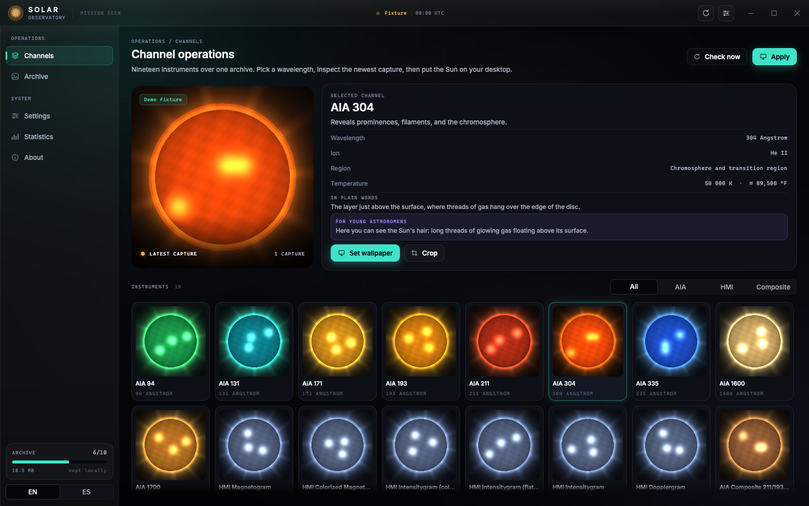
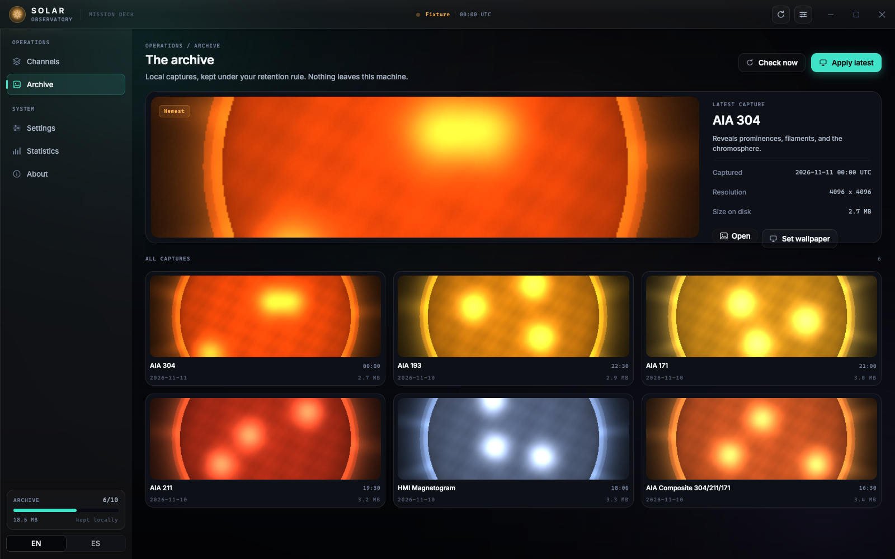
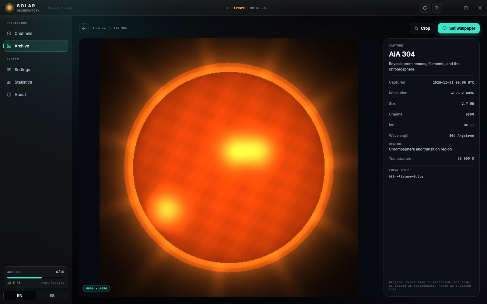
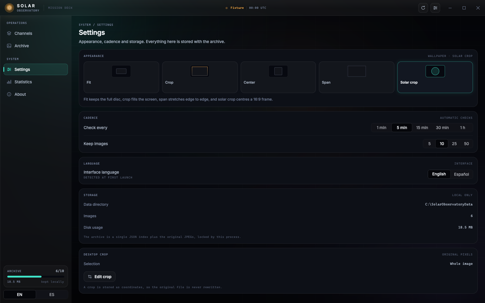
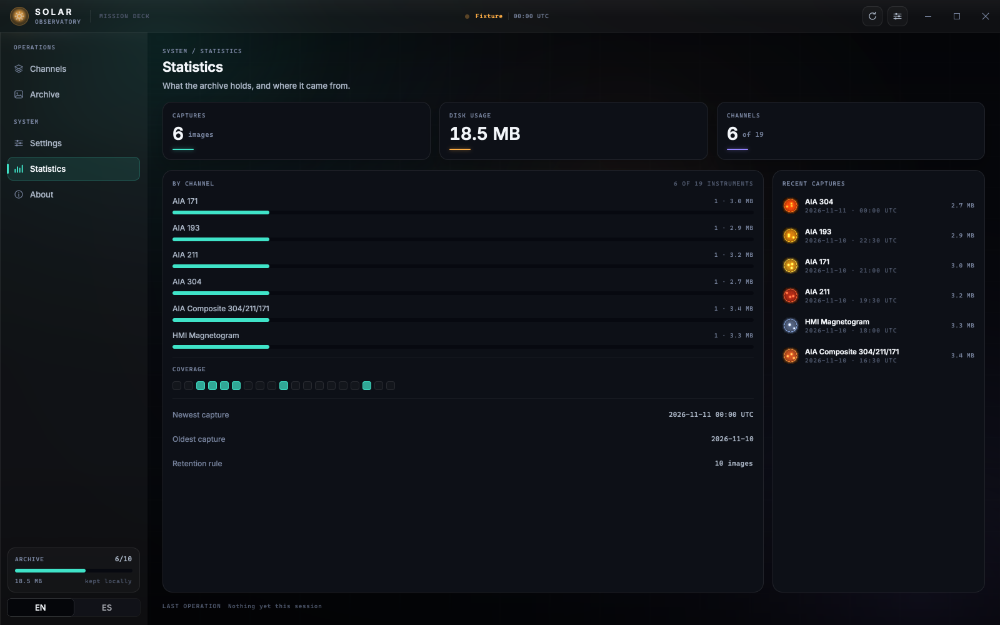
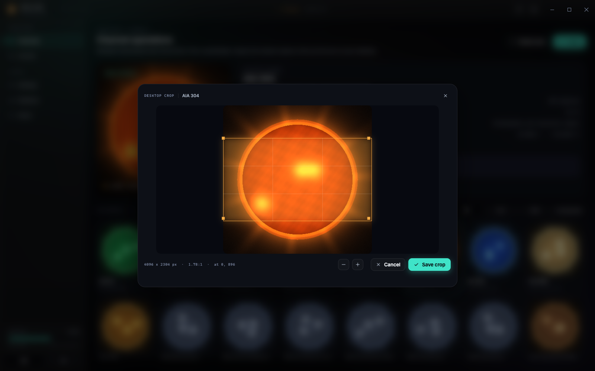
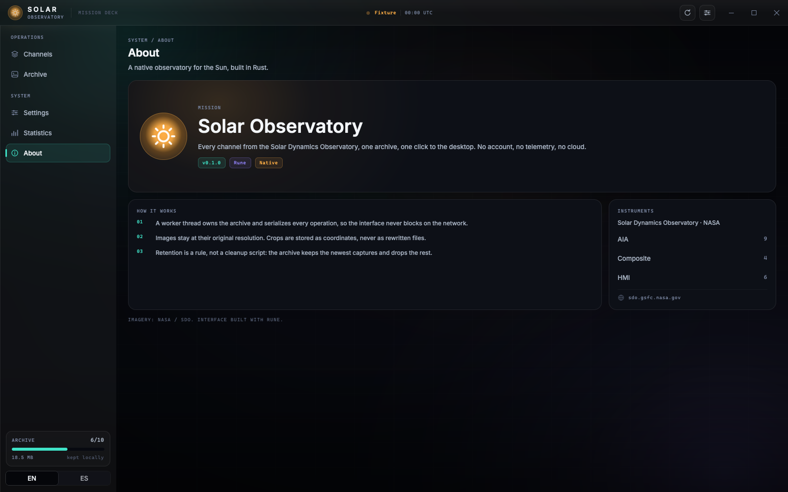

# Solar Observatory

A native desktop observatory for the Sun, written in Rust with
[Rune](https://github.com/anomalyco/rune) (`38e75af6c22915c01d5e219f53d5f0af6edf9a11`).
Nineteen SDO channels, a local archive under a retention rule, crop editing, and one-click
wallpaper on Windows, macOS and Linux.

The interface is called **Mission Deck**: glass panels over an aurora field, a full-disc hero
for the selected instrument, and a rack of instruments that reflows into as many columns as the
window holds. It is dark-only in this version, and bilingual (English and Spanish) for all
UI chrome and catalogue prose.

## Screens

[](docs/screenshots/channels.png)

<table>
  <tr>
    <td width="50%"><a href="docs/screenshots/gallery.png"></a><br><strong>Archive</strong></td>
    <td width="50%"><a href="docs/screenshots/detail.png"></a><br><strong>Capture detail</strong></td>
  </tr>
  <tr>
    <td width="50%"><a href="docs/screenshots/settings.png"></a><br><strong>Settings</strong></td>
    <td width="50%"><a href="docs/screenshots/statistics.png"></a><br><strong>Statistics</strong></td>
  </tr>
  <tr>
    <td width="50%"><a href="docs/screenshots/crop.png"></a><br><strong>Crop editor</strong></td>
    <td width="50%"><a href="docs/screenshots/about.png"></a><br><strong>About</strong></td>
  </tr>
</table>

The captures use deterministic fixture data and do not modify the archive or desktop. See
[`docs/screenshots`](docs/screenshots/README.md) for the screen index and regeneration command.

## License

The project source code is licensed under [Apache-2.0](LICENSE). NASA/SDO imagery, including
the bundled previews in `content/previews/`, is excluded from this license and remains subject
to NASA/SDO's own usage terms. The application attributes this imagery to NASA/SDO. See
[`content/PROVENANCE.md`](content/PROVENANCE.md).

## Run

Requires the Rust stable toolchain, a C++ build toolchain for the host, and a working GPU
backend.

```powershell
cargo run --locked
```

The first build needs network access and writes to Cargo's user cache and `target/`.

To inspect the shell without touching the archive or the desktop:

```powershell
$env:SOLAR_OFFLINE = "1"
cargo run --locked -- --scene demo --snap artifacts/demo.png --size 1180x820 --scale 2
```

Scenes: `demo`, `channels`, `gallery`, `detail`, `settings`, `statistics`, `about`, `crop`,
`spanish`. A scene renders procedural solar imagery, never downloads, and never writes to the
data directory.

## What it does

- **Channels** — every bundled SDO product with wavelength, ion, region and temperature in both
  kelvin and the reader's own scale (Celsius in Spanish, Fahrenheit in English); hero preview at
  full disc (never cropped), the channel explained three ways — technical, plain language, and a
  child's picture of it — and a filterable grid of square instrument tiles that never scrolls
  sideways.
- **Archive** — every kept capture, newest first, with a detail view and on-disk facts.
- **Wallpaper** — `Fit`, `Crop`, `Center`, `Span` and `Solar crop`, set through the system that
  owns the desktop: `IDesktopWallpaper` on Windows, `NSWorkspace` on macOS, and the desktop
  environment's own tool on Linux. The platform is detected at compile time, so the same build
  always does the right thing for the machine it runs on.
- **Retention** — per-channel cap, enforced after every download; the active wallpaper and the
  crop source are never deleted. If the active wallpaper cannot be read, nothing is removed.
- **Scheduled checks** — a worker thread owns the archive; the UI sends commands and renders
  snapshots. Conditional fetches reuse the stored `Last-Modified` and skip unchanged images.
- **Crop editor** — drag and zoom over the capture, stored as coordinates, never as a second
  full-size file in the archive.
- **Preferences** — language, interval, retention, mode and crop persist in `archive.json`.

Data lives in `%LOCALAPPDATA%\SolarObservatory` on Windows and
`$XDG_DATA_HOME/solar-observatory` (`~/.local/share/solar-observatory`) elsewhere; override
with `SOLAR_DATA_DIR`.

## Wallpaper per system

| System | How the picture is set | Read back |
|---|---|---|
| Windows | `IDesktopWallpaper`, position and image together, every monitor | yes |
| macOS | `NSWorkspace` per screen, on the main queue; System Events if the desktop keeps the old picture | yes |
| Linux | GNOME/Cinnamon/MATE `gsettings`, XFCE `xfconf-query`, KDE `plasma-apply-wallpaperimage`, Sway `swaymsg`, Hyprland `hyprctl`, then `feh`/`xwallpaper`/`hsetroot` on plain X11 | GNOME family and XFCE |

Read-back is what the retention rule depends on: when a system cannot report the current
picture, the app treats it as unknown and deletes nothing. KDE, Sway, Hyprland and bare X11
fall in that group, so cropped derivatives accumulate there until the archive is trimmed.

`Span` is a Windows and GNOME idea. macOS and the other Linux tools have no cross-screen mode,
so they use the closest thing they have — a picture that covers the screen.


## Verify

```powershell
cargo clippy --all-targets --locked -- -D warnings
cargo test --locked
```

The suite covers the catalogue and its translations, crop geometry, retention protection,
settings persistence, conditional downloads, the preview-cache window, the wallpaper mode
mapping on each backend, the Linux desktop detection and its command plans, and the generated
app icon together with the ICO the executable embeds. The real-desktop wallpaper round trip is `#[ignore]`d because it changes the user's
wallpaper; run it with `cargo test -- --ignored windows_wallpaper_round_trip`.

CI runs clippy and the tests on Windows, macOS and Linux, and renders a headless snapshot on
Windows.

A headless snapshot proves layout and painting, not the native window. For the window itself,
run the app and look at it.

## Layout

```
src/main.rs            Rune AppSpec, scenes, custom titlebar, app icon
src/application.rs     Service<S>: one owner of the archive, per-stage Outcome
src/domain/            catalog, crop, lifecycle (retention), Archive/Record/Preferences
src/infrastructure/    nasa (HTTP), storage (filesystem), wallpaper/{windows,macos,linux}
src/ui/                State, worker thread, theme, icons, art, components
src/ui/views/          chrome, channels, gallery, detail, settings, statistics, about, crop
content/               channels.json (19 SDO products) + reference previews
assets/                app.ico + app.rc, embedded into the executable on Windows
```

See `docs/STATUS.md` for the living implementation tracker and
`RUNE_FUNCTIONAL_EXPORT.md` for the functional baseline.

## Notes

- Rune is pinned to a revision; keep `Cargo.lock`. `.external/rune` is a reference checkout,
  not a build dependency.
- The window uses Rune's own titlebar (`App::titlebar`) so the caption buttons follow the app's
  theme. The icon is drawn procedurally: `rune::set_app_icon` gives the running window its title
  bar and taskbar icon, and `build.rs` embeds the committed `assets/app.ico` so Explorer, Start
  and pinning show the same Sun. After changing the art, regenerate the asset with
  `$env:SOLAR_ICON_WRITE="1"; cargo test --bin solar-rust icon_resource`.
- On Windows the binary is a GUI app (`windows_subsystem`), so double-clicking it opens no
  terminal window; launched from a shell it attaches to that console, so the startup banner and
  the snapshot runs still print.
